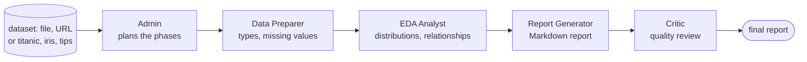

# AutoGen + Claude Agents for Exploratory Data Analysis

**A team of specialized agents (admin, data preparer, EDA analyst, report generator, critic) that takes a dataset and produces an exploratory-analysis report, built on Microsoft AutoGen with a custom model client so the agents run on Claude.**

[](https://colab.research.google.com/github/dojedaro/autogen-claude-eda-agents/blob/main/autogen_claude_eda.ipynb)
[](https://github.com/dojedaro/autogen-claude-eda-agents/actions/workflows/notebooks.yml)

## Example run

On the Titanic dataset (891 passengers, 15 columns, target `survived`), the five agents worked through
data preparation, analysis, reporting and review, and wrote a Markdown EDA report to
`eda_workspace/final_report/final_eda_report.md`. The notebook's saved outputs show each phase.

## How it works



- **Agents:** AutoGen `AssistantAgent`s, each with its own role prompt, plus an executor agent for code.
- **Claude through AutoGen:** AutoGen ships OpenAI-style model clients, so the notebook implements a
  custom `ChatCompletionClient` that translates AutoGen's message format to the Anthropic Messages API.
  That adapter is the reusable part of this project.
- **Orchestration:** the executed workflow runs the agents' prompts in a fixed sequence of phases
  rather than an AutoGen group chat, so the order is predictable and each phase's output feeds the
  next.

## Run it

```bash
pip install -r requirements.txt
jupyter notebook autogen_claude_eda.ipynb
```

The notebook asks for an Anthropic API key with `getpass`. It pins Claude 3 Sonnet and Claude 3.5
Sonnet model IDs, which Anthropic has retired; replace them with a current model such as
`claude-sonnet-5-5` before running.

## Stack

Python, Microsoft AutoGen (agentchat, core), Anthropic SDK, pandas, NumPy, Matplotlib, seaborn, Plotly.

## Limitations and next steps

- **No check that the report is right.** The critic agent reviews the report, but nothing compares the
  report's statistics with values computed in code. A cheap fix: compute the key numbers in pandas and
  require the report to quote them.
- A fixed sequence doesn't need a multi-agent framework; a group chat with a selector would let the
  critic send work back, which is what the framework is for.
- Update the model IDs and AutoGen version, which has changed its API since this was written.

*Extracted on 2026-11-13 from a catch-all coursework repository into its own project.*

## License

MIT
